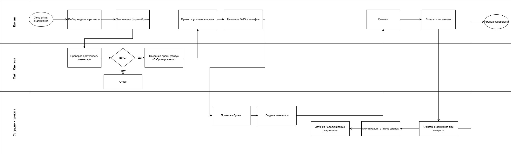
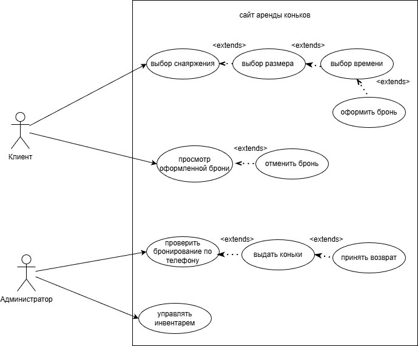
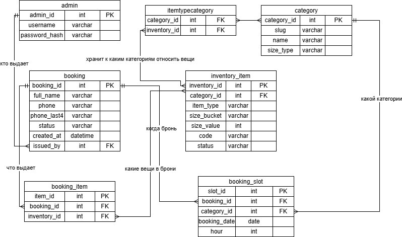
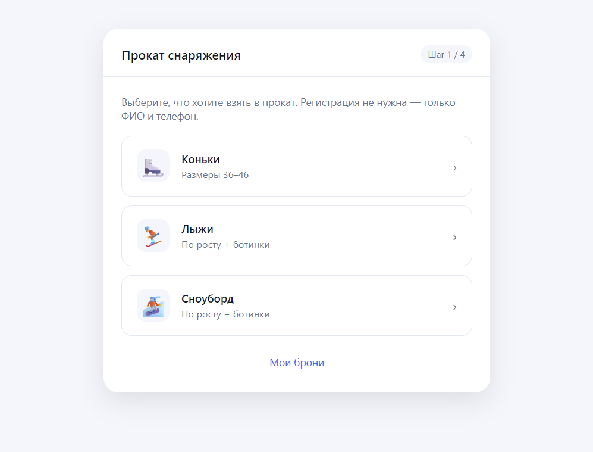
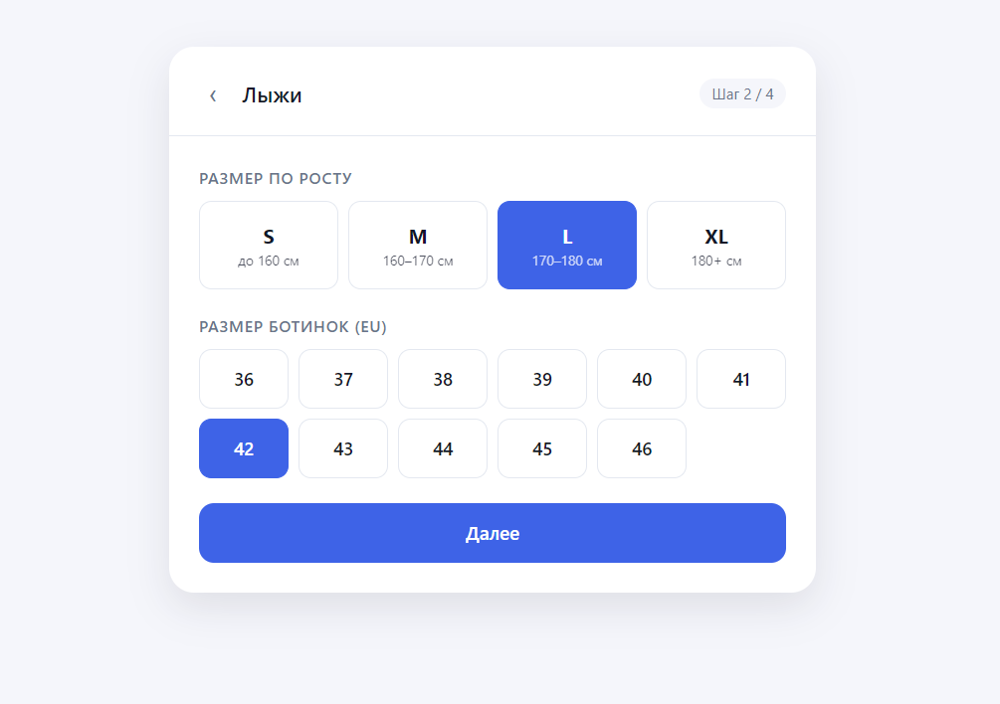
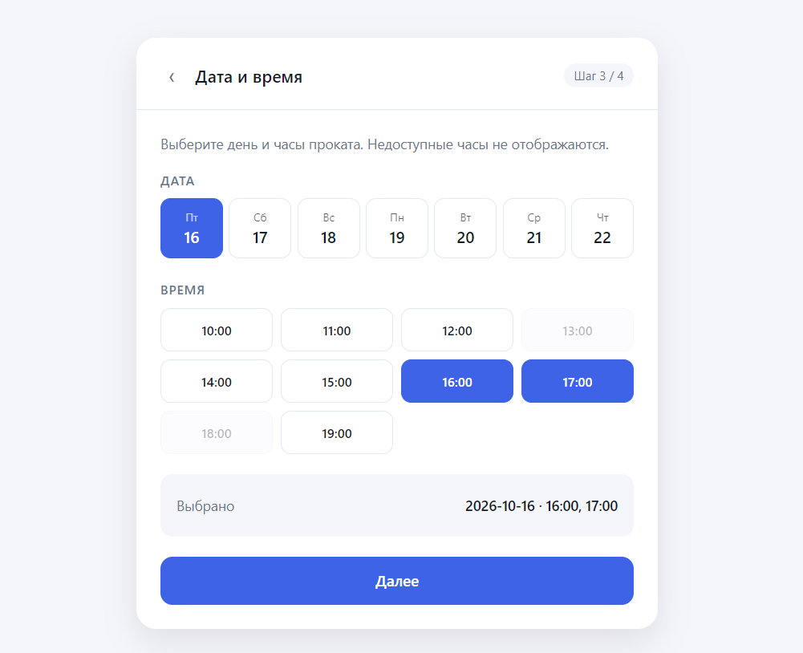
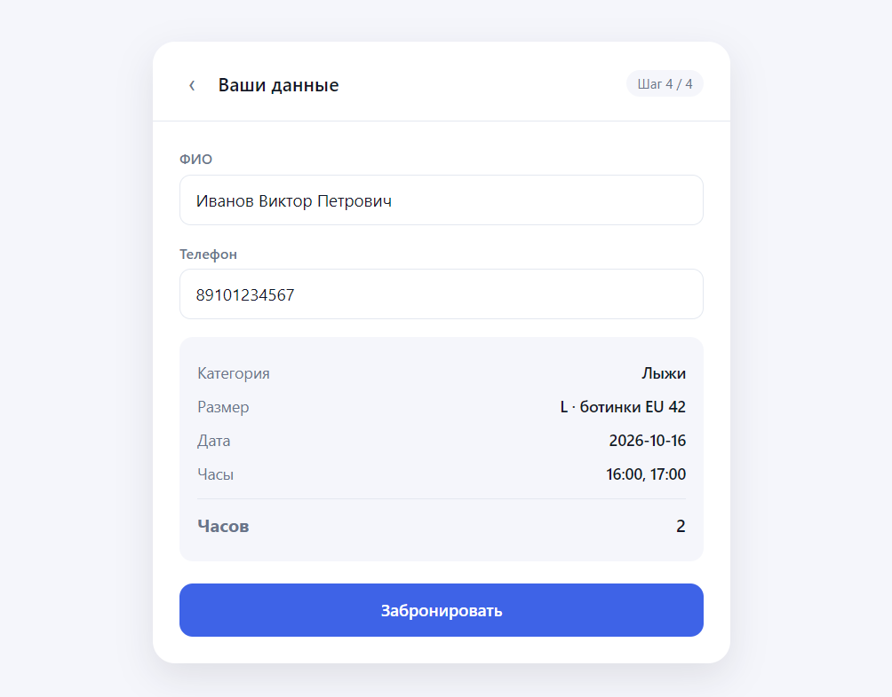
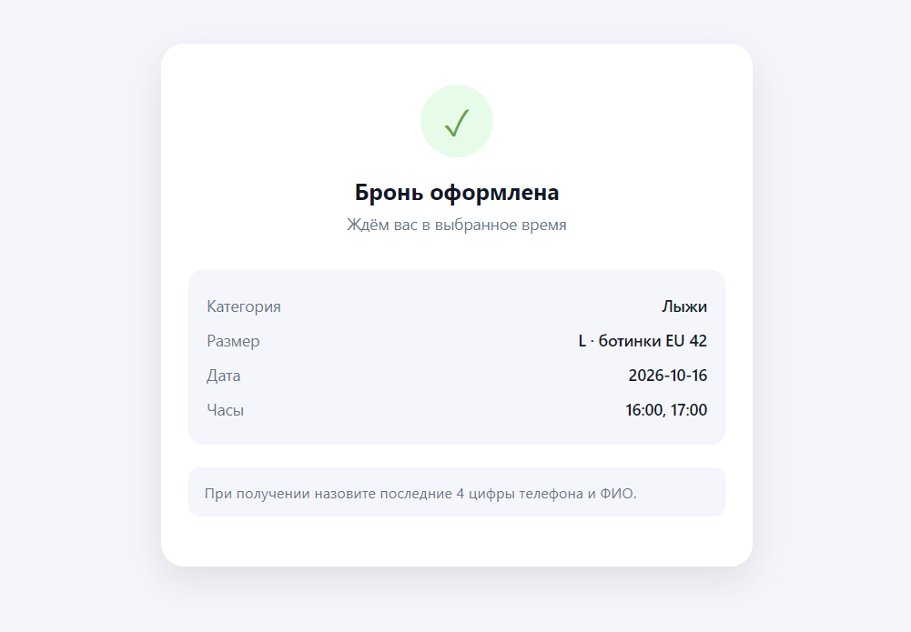

# Прокат горнолыжного снаряжения. Аналитика

## Описание нашего сервиса

Прокат снаряжения - веб-приложение для бронирования спортивного инвентаря (коньков, лыж, сноубордов) без регистрации. Предусмотрено две роли: гость и администратор. Гость - единственная публичная роль - просматривает каталог, выбирает категорию и размер, бронирует снаряжение на свободные часы. Администратор авторизуется в системе, управляет инвентарём, выдаёт снаряжение по последним 4 цифрам телефона и ФИО, принимает возврат и фиксирует поломки.

Сервис решает одну задачу - забронировать конкретный инвентарь на конкретный час.

## Обзор существующих решений

Офлайн-пункты проката при катках и горнолыжных базах. Это самый распространённый формат. Клиент приезжает на место, оставляет залог, получает снаряжение по факту наличия. Ключевая проблема - отсутствие предварительного резервирования. Человек едет на каток, не зная есть ли вообще его размер. Если на месте выясняется, что нужного размера нет, то поездка оказывается напрасной, а учитывая, что обычно в такие поездки едут семьями, то вероятность отсутвия нужного размера для 4 человек, выше. Кроме того, в пиковые часы (выходные, праздники, вечернее время) образуются очереди на выдачу.

Маркетплейсы и доски объявлений (Avito, Юла). Здесь можно найти частные объявления о сдаче снаряжения в аренду, но это разовые сделки без гарантий. Нет единого инвентарного учёта, нет системы бронирования по часам, нет защиты от двойного бронирования. Каждый арендодатель работает сам по себе, и пользователь не может быть уверен, что снаряжение действительно свободно и соответствует описанию.

Наш сервис закрывает нишу: онлайн-бронирование без регистрации, с прозрачной сеткой свободных часов и гарантией, что нужный размер будет ждать клиента.

## Функциональные требования

- Просмотр каталога категорий
- Выбор размера инвентаря: EU-размер для коньков и ботинок, для лыж и сноуборда полный выбор снаряжения от самих лыж до шлема и верхней одежды
- Календарь свободных часов на 7 дней вперёд
- Бронирование без регистрации: ФИО и телефон
- Ограничение на количество активных броней на один телефон
- Просмотр своих броней по номеру телефона
- Отмена брони с подтверждением
- Выдача инвентаря администратором по последним 4 цифрам телефона и ФИО
- Приём возврата и фиксация поломок
- Управление инвентарём: добавление и удаление единиц по каждой категории
- Логика непрерывной брони: коньки, лыжи и сноуборд - любые часы в течении дня

## Нефункциональные требования

- Нормализация телефонного номера при сохранении
- Защита от race condition: два клиента не могут забронировать последнюю единицу на один час
- Чужие брони недоступны: на запрос по чужому телефону возвращаются только брони этого телефона
- Лимит активных броней на один номер телефона
- Свободные часы вычисляются динамически с учётом активных броней
- Прошедшие часы не показываются в календаре
- Интерфейс интуитивен и не требует инструкции

## Архитектура

Диаграмма деятельности. Дорожки: Гость, Система, Админ. Поток: выбор категории и размера, проверка доступности, создание брони, выдача администратором, возврат.

## Стек технологий

Бэкенд: Python, FastAPI, SQLAlchemy, Pydantic, Alembic, PostgreSQL

Фронтенд: TypeScript

Тестирование: Pytest

## Use Case

Диаграмма вариантов использования. Роли: Гость, Админ. Гость просматривает категории, выбирает размер и часы, оформляет и отменяет бронь, смотрит свои брони по телефону. Админ авторизуется, управляет инвентарём, просматривает брони, выдаёт снаряжение и принимает возврат.

## Диаграмма сущностей БД

Основные сущности: Category, InventoryItem, Admin, Booking, BookingSlot, BookingItem.

## Описание экранов

1. Выбор категории.

2. Выбор размера. Для коньков - сетка EU-размеров 36–46. Для лыж и сноуборда - два блока: по росту (S/M/L/XL) и размеру ноги (EU 36–46).

3. Календарь и часы. Семь дней начиная с сегодняшнего. 

4. Форма брони. Два поля: ФИО и телефон, ниже сводка брони.

5. Сообщение об успешной брони и сводка.

