# Прокат горнолыжного снаряжения. Отчёт.

## Описание проекта

«Скользи!» — веб-приложение для онлайн-бронирования горнолыжного инвентаря (коньков, лыж, сноубордов) без регистрации. 
Клиент заходит на сайт, выбирает снаряжение, размер и свободные часы, оставляет ФИО и телефон. При получении он называет последние 4 цифры телефона или показывает qr-код, а сотрудник находит бронь в административной панели и выдает снаряжение.

## Бэкенд (FastAPI)
Реализована слоистая архитектура:
- **Routers** — принимают HTTP-запросы и валидируют параметры.
- **Services** — бизнес-логика (транзакции, проверка доступности).
- **Models** — структура базы данных (SQLAlchemy).
- **Schemas** — Pydantic-модели для валидации и документации.

## Фронтенд (React + TypeScript + Vite)
- **Pages** — экраны приложения (Главная, Бронирование, Мои брони, Админка).
- **Components** — переиспользуемые UI-элементы (модалки, таблицы размеров).
- **API-клиент** — централизованная обработка запросов и JWT-авторизации.

## База данных

## Сценарии использования

В системе две роли:
1. **Клиент** — бронирует снаряжение, смотрит свои брони по телефону, отменяет бронь, продлевает время.
2. **Администратор** — авторизуется, управляет инвентарем, выдает/принимает снаряжение (сканирует QR).

## Клиентская часть
- Выбор категории и полная комплектация.
- Выбор пола (для правильного подбора размеров одежды) и интерактивные таблицы размеров.
- Календарь на 7 дней с динамическим расчетом свободных часов.
- Создание брони, генерация QR-кода для быстрой выдачи.
- Поиск своих броней по телефону, отмена и **продление** брони.

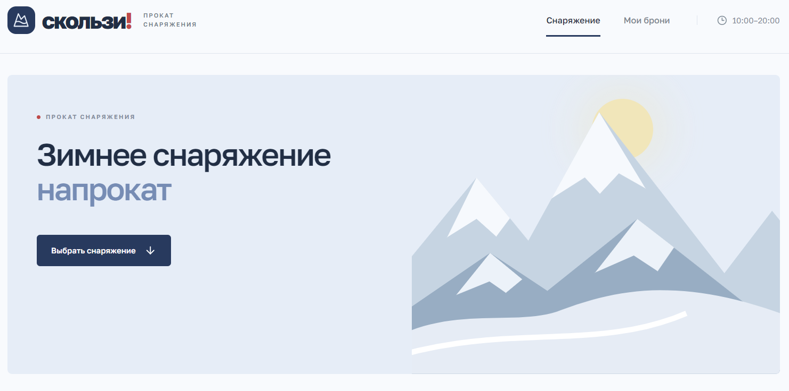
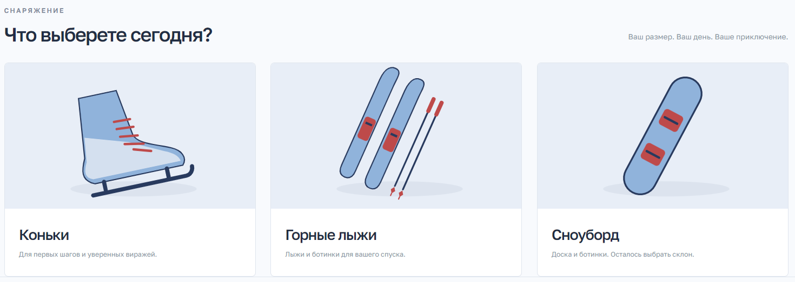
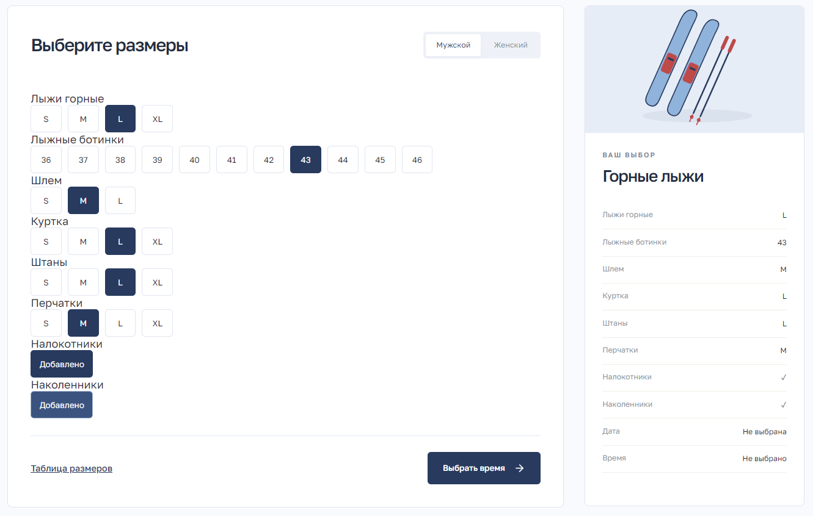
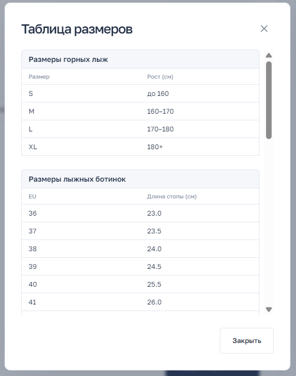
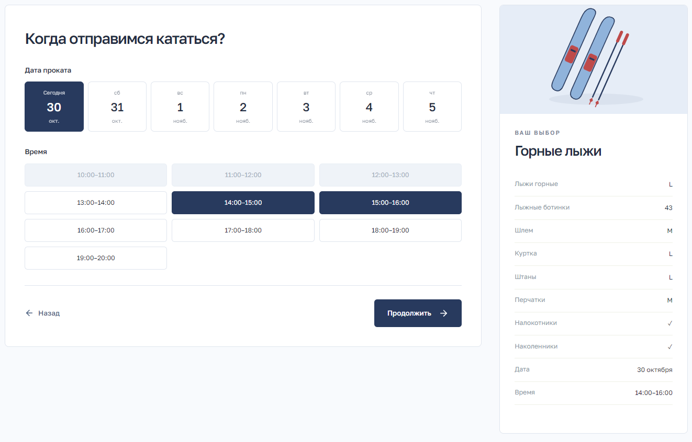
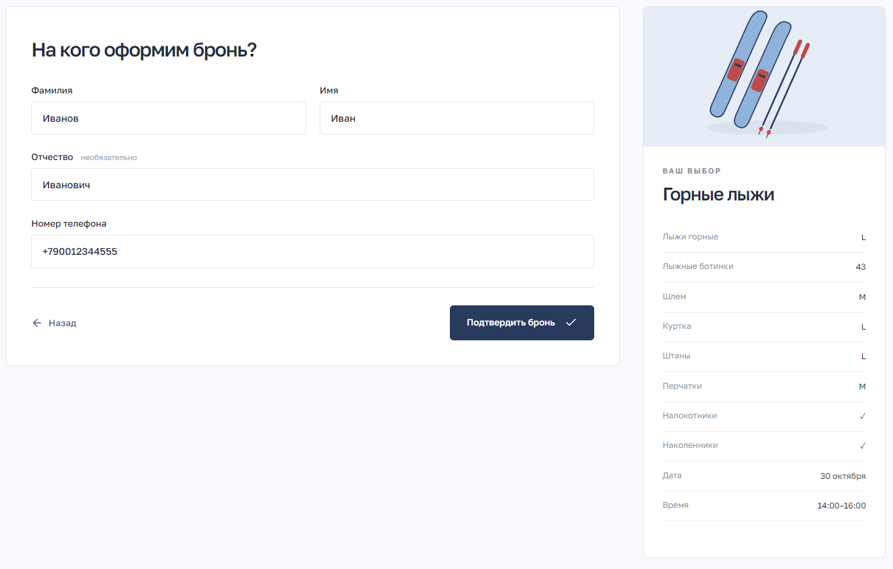
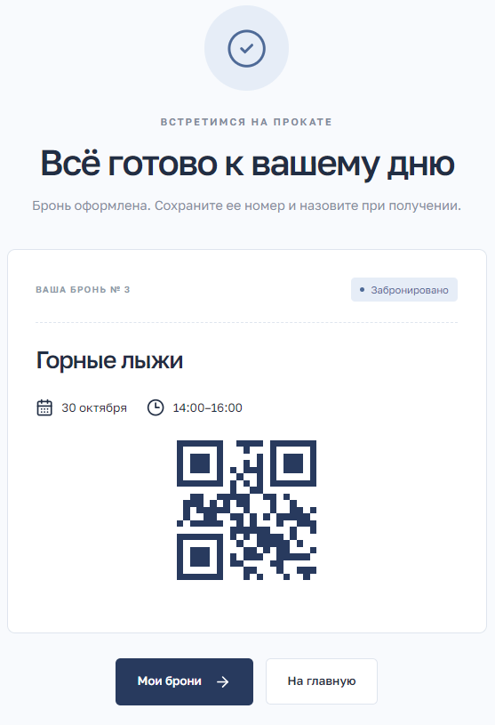
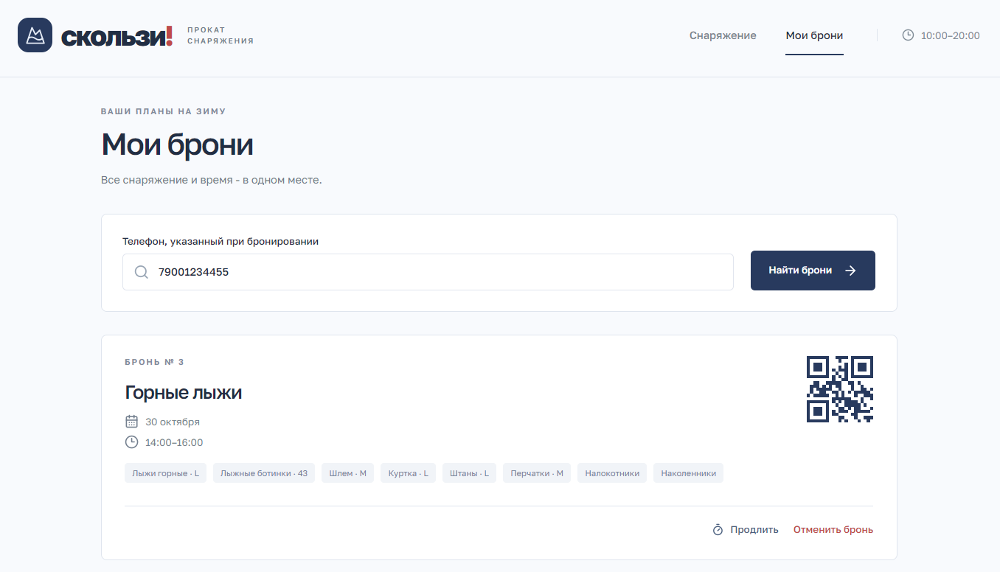
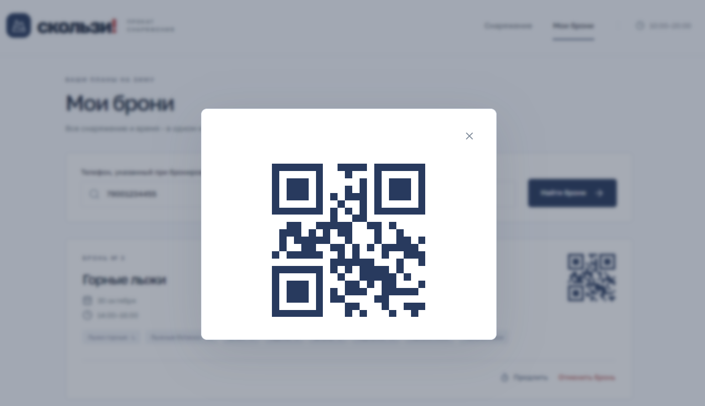
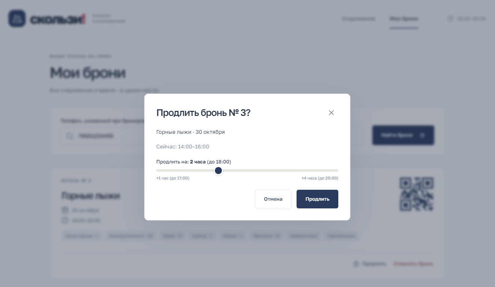
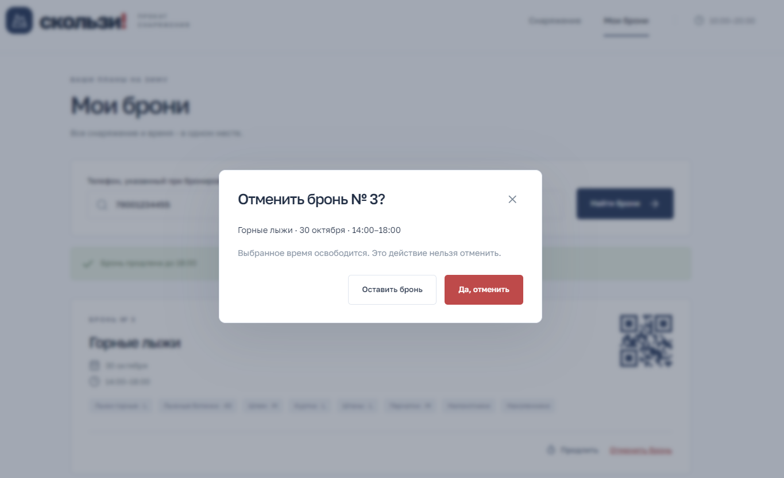

## Административная часть
- Поиск броней по номеру телефона или номеру брони (ID).
- Выдача инвентаря (смена статуса на `issued`, инвентарь становится `rented`).
- Прием возврата (статус `completed`, инвентарь снова `available`).
- Управление складом: добавление, удаление, списание (статус `broken`).

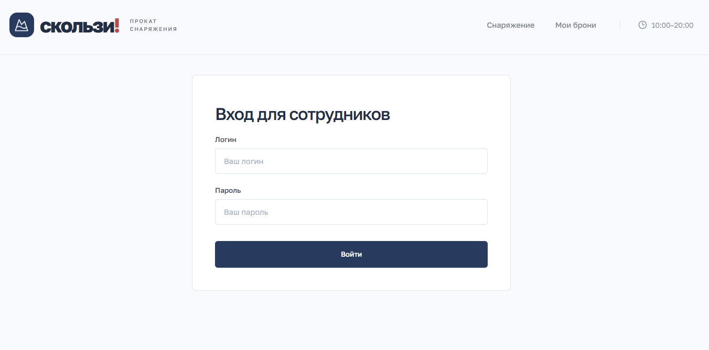
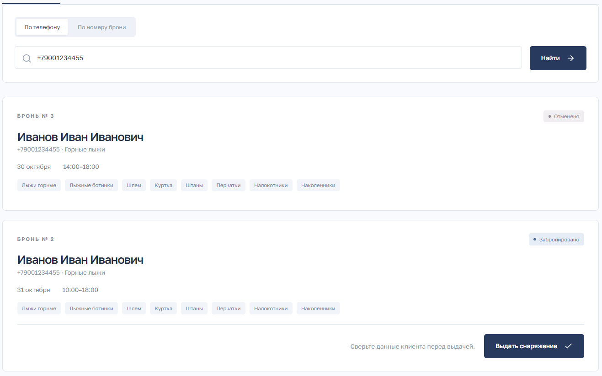
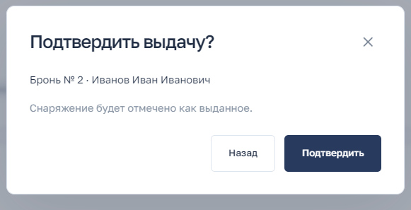
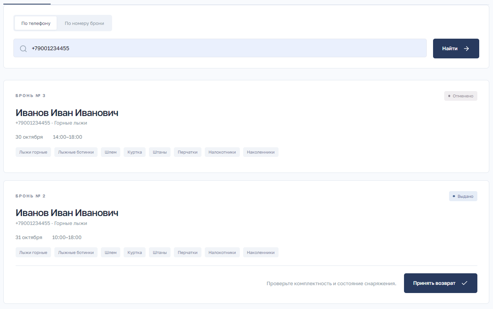
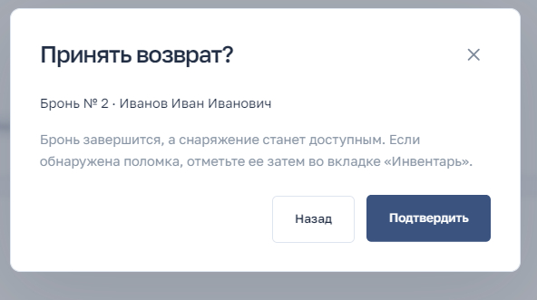
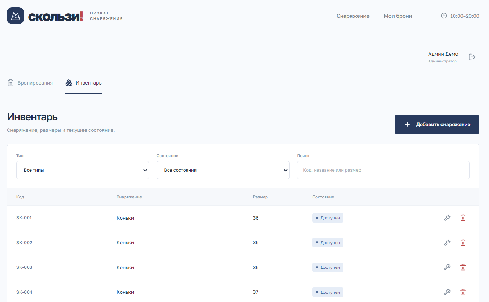